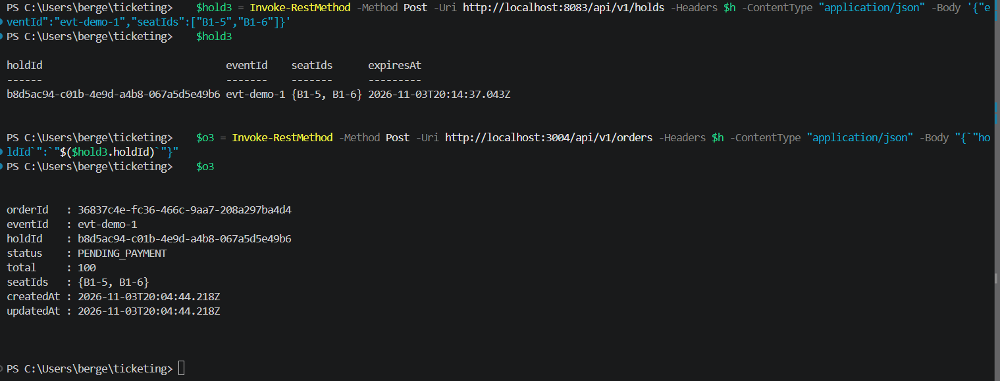
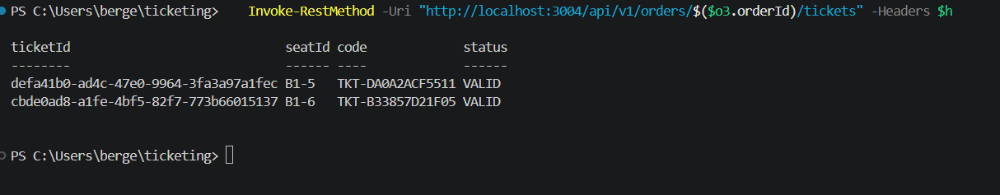
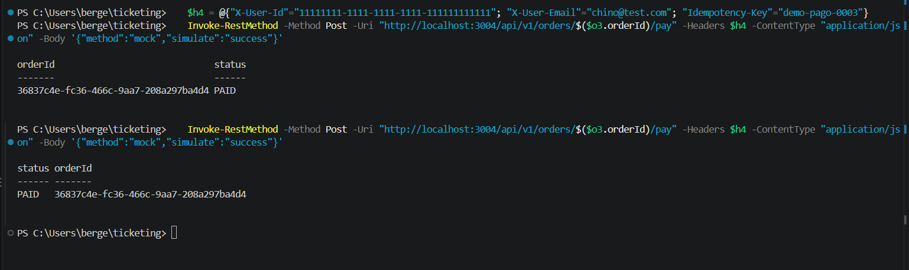
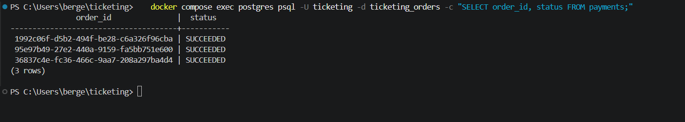
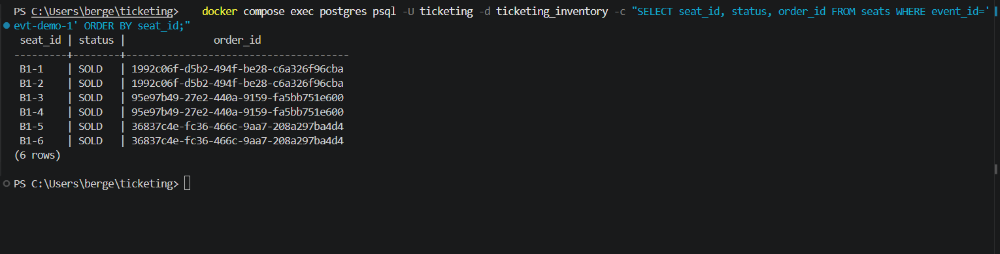
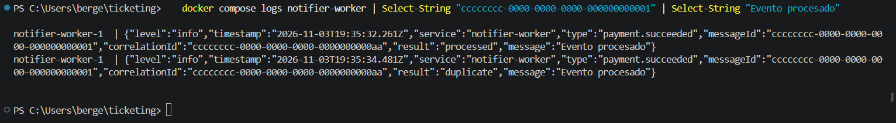
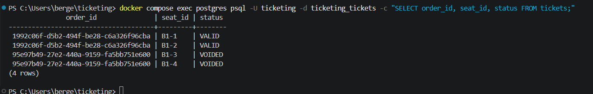
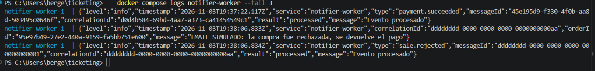
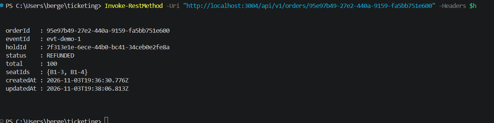
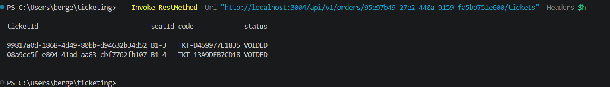

   # Decisiones del Rol 4 — Pedidos, pagos y notificaciones

## 1. REST vs mensajería (cuándo uso cada uno y por qué)
**Criterio:** REST cuando quien llama necesita la respuesta ahora para seguir; mensajería cuando el trabajo puede hacerse después y no debe bloquear ni acoplar a los servicios.

**REST (síncrono), en la ruta crítica del usuario:**
- `POST /orders`: orders consulta el hold a inventory (`GET /holds/{id}`) porque tiene que saber ya si el hold existe, es del usuario y no venció.
- `POST /orders/{id}/pay`: orders extiende el hold (`POST /holds/{id}/extend`) antes de cobrar; el usuario espera el resultado del pago.
- Costo: si inventory está caído, devuelve 502 y el usuario reintenta. Se acepta porque sin esa confirmación no se puede cobrar con seguridad.

**Mensajería (RabbitMQ, asíncrono), para lo que pasa después del pago:**
- `payment.succeeded` / `payment.failed`: inventory marca `SOLD` o libera; el notifier emite entradas y simula el email. El usuario no tiene que esperar eso.
- `ticket.issued`, `hold.expired` y `sale.rejected` (compensación).
- Beneficios: desacoplamiento (orders no conoce al notifier), tolerancia a fallas (si el notifier está caído, el mensaje espera en la cola) y reintentos.
- Costo: consistencia eventual. Por eso el front reintenta `GET /orders/{id}/tickets` hasta que aparezcan las entradas.

**Por qué no todo REST:** acoplaría orders a inventory y notifier; si uno cae, el pago falla.
**Por qué no todo mensajería:** el usuario necesita respuesta inmediata en el pago y el hold.

## 2. Saga y compensación (pasos, estados del pedido)
**Problema:** la compra involucra tres servicios con bases distintas (inventory, orders, notifier) y no hay una transacción que las abarque. Si algo falla a mitad de camino, hay que deshacer los pasos anteriores.

**Decisión:** saga coreografiada por eventos en RabbitMQ, sin orquestador central. Cada servicio reacciona a eventos y publica los suyos.

**Camino feliz:** hold (inventory, asientos `HELD`) → pedido `PENDING_PAYMENT` → extender hold y pago simulado → `payment.succeeded` → inventory marca `SOLD` y el notifier emite las entradas (`ticket.issued`).

**Compensaciones:**
- **Pago rechazado:** orders publica `payment.failed` y el pedido queda `PAYMENT_FAILED`; inventory libera los asientos. No se reintenta el mismo pedido: el usuario hace un hold nuevo.
- **Hold vencido antes de pagar:** inventory publica `hold.expired` (o el pago devuelve 410) y el pedido pasa a `EXPIRED`.
- **Venta imposible tras el cobro** (hold vencido y asientos tomados por otro): inventory publica `sale.rejected`; orders pasa el pedido `PAID` a `REFUNDED` (devolución simulada) y las entradas a `VOIDED`.

**Estados del pedido:** `PENDING_PAYMENT → PAID | PAYMENT_FAILED | EXPIRED | REFUNDED`.

**Prevención de la carrera:** orders extiende el hold justo antes de cobrar (`POST /holds/{id}/extend`), para que no venza en medio del pago.

**Cómo se probó:** `sale.rejected` publicado desde el panel de RabbitMQ: pedido `PAID` → `REFUNDED` y entradas `VALID` → `VOIDED`. Se armó a mano porque en la realidad lo publica inventory al detectar el conflicto.

## 3. Idempotencia del pago (Idempotency-Key)
**Problema:** si el usuario hace doble clic en "Pagar", o el front reintenta por un corte de red, el mismo pago puede llegar dos veces y cobrarse dos veces.

**Decisión:** `POST /orders/{id}/pay` exige un header `Idempotency-Key`. La clave se reserva en la tabla `idempotency_keys` dentro de la base, antes de cobrar. Según el caso:
- **Misma clave, misma solicitud(se compara un hash del cuerpo, request_hash), ya terminada:** se devuelve la misma respuesta guardada, sin volver a cobrar (200).
- **Misma clave mientras el primer pago sigue en curso:** 409 `PAYMENT_IN_PROGRESS`.
- **Misma clave con otro cuerpo:** 422 `IDEMPOTENCY_KEY_REUSED`.
- **Sin clave:** 400 `IDEMPOTENCY_KEY_REQUIRED`.
- **Inventory caído al pagar (502):** la clave se libera, así el cliente puede reintentar con la misma.
- **Hold vencido al pagar (410):** el pedido pasa a `EXPIRED` y la respuesta 410 queda guardada con la clave.

**Cómo se probó:** se pagó dos veces con la misma clave; ambas devolvieron `PAID` y la tabla `payments` tiene una sola fila `SUCCEEDED`.

**Para el front:** UUID nuevo por cada intento de pago, y la misma clave si reintenta el mismo pago.

## 4. Outbox (publicar eventos sin perderlos)
**Problema:** al cobrar hay que guardar el pedido como `PAID` (Postgres) y publicar `payment.succeeded` (RabbitMQ). Son dos sistemas y no comparten transacción: si se cae RabbitMQ justo después de guardar, el pedido queda pagado y nadie se entera (inventory no marca `SOLD`, no se emiten entradas).

**Decisión:** el cambio de estado y el evento se guardan juntos en la tabla `outbox`, en una sola transacción de Postgres: o se hacen las dos cosas o ninguna. Un worker aparte lee la tabla, publica en RabbitMQ y recién ahí marca `published_at`. Si RabbitMQ está caído, reintenta.

**Consecuencia:** la entrega es at-least-once (un evento puede publicarse más de una vez). Por eso todos los consumidores son idempotentes con `processed_messages` (sección 5).

## 5. Consumidores idempotentes y DLQ
**Problema:** RabbitMQ entrega at-least-once, así que un mismo mensaje puede llegar más de una vez, y también pueden llegar desordenados.

**Decisión:** cada consumidor registra el `messageId` en `processed_messages` **dentro de la misma transacción** que aplica el efecto (`INSERT ... ON CONFLICT DO NOTHING`). Si el mensaje ya estaba, se responde `duplicate` y no se hace nada. Si algo falla, se revierte todo, incluido el registro, y el mensaje se puede reprocesar.

**Orden invertido:** si `sale.rejected` llega antes que `ticket.issued`, las entradas se crean directamente `VOIDED`. Los inserts de entradas usan `ON CONFLICT DO NOTHING`.

**Colas de orders:** `orders.events`, con `hold.expired`, `sale.rejected` y `ticket.issued`. Del notifier: `notifier.events` (`payment.succeeded`, `sale.rejected`).

**DLQ:** cada cola tiene su dead-letter queue en el exchange `ticketing.events.dlx` (tipo `topic`, igual en todos los servicios; antes estaba `direct` en inventory y fallaba el arranque). Un mensaje va a la DLQ cuando su procesamiento falla por cualquier motivo (JSON inválido, datos que no cumplen el esquema, error de base): se hace `nack` sin reencolar. Si sale bien, el `ack` se envía recién después de confirmar la transacción, así que un corte a mitad de camino no pierde el mensaje. Limitación: no hay reintentos antes de la DLQ (mejora futura: reintentos con backoff).

**Cómo se probó:** el mismo `payment.succeeded` publicado dos veces desde el panel de RabbitMQ: la segunda dio `result: duplicate` y no se duplicaron entradas.
## 6. Decisiones puntuales
- **Puerto 3004:** sigue el estilo de users-service (3001). El contrato original proponía 8084, pero lo cambiamos para no mezclar con el 8083 del inventory.
- **`pg` directo, sin ORM:** SQL explícito y control claro de las transacciones, que es lo crítico para la idempotencia, el outbox y la saga. Se descartó Prisma por curva de aprendizaje.
- **`ticket.issued` obligatorio:** el notifier no tiene HTTP, así que nadie podía leer las entradas. Orders las guarda al recibir `ticket.issued` y las sirve en `GET /orders/{id}/tickets`.
- **`event_id` como text:** los eventos de inventory usan ids de texto (ej. `evt-demo-1`), no UUID.
- **Extender el hold antes de cobrar:** propuesta de Lucas (`POST /holds/{id}/extend`) más `sale.rejected` como plan B, para la carrera entre expiración y pago.
- **Una base lógica por servicio:** orders usa `ticketing_orders` y el notifier `ticketing_tickets`; nadie lee tablas de otro.

## 7. Pruebas y screenshots
Todas las pruebas se hicieron con `main` limpio, con `docker compose up` desde cero (`down -v`), el inventory real de Lucas y el notifier.

| # | Prueba | Resultado | Screenshot |
|---|---|---|---|
| 1 | Flujo feliz: hold, pedido, pago | Pedido `PENDING_PAYMENT` y luego `PAID`; entradas `VALID` |   |
| 2 | Idempotencia del pago (misma `Idempotency-Key`) | Ambas respuestas `PAID`; un solo cobro por pedido en `payments` |   |
| 3 | Asientos en inventory tras el pago | `B1-5` y `B1-6` en `SOLD` con el `order_id` |  |
| 4 | Idempotencia del notifier (mismo `messageId`) | Log `processed` y luego `duplicate`; no se duplican entradas |   |
| 5 | Compensación (`sale.rejected`) | Pedido `PAID` a `REFUNDED`; entradas a `VOIDED`; email simulado de devolución |    |