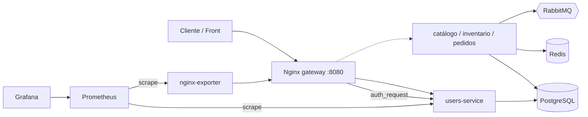

# Observabilidad — borrador Rol 1

## Logs
Los servicios escriben logs estructurados JSON por stdout/stderr. En users-service se incluyen timestamp,
level, service, correlationId, método, ruta, status y duración. No se registran contraseñas ni tokens.

## Correlation ID
Nginx usa el header `X-Correlation-Id` recibido si existe; si no, crea un `$request_id`. Lo devuelve en la respuesta y aparece tanto en el log del gateway como en el de users-service (verificado de punta a punta).
El identificador se propaga a users-service. Los demás servicios deben adoptar el mismo header y
propagarlo también a las llamadas REST y mensajes.

## Métricas
Prometheus scrapea `users-service:3001/metrics` y el exporter de Nginx.
Users-service expone contadores HTTP, histograma de latencia, registros y logins exitosos/fallidos.
El dashboard Grafana presenta requests, latencia p95, registros, logins y conexiones de Nginx.

## Arquitectura (parte Rol 1)

El gateway es el único punto de entrada: aplica rate limiting, genera/propaga el `correlationId` y valida el JWT antes de reenviar a los servicios, que reciben la identidad por cabeceras.

## Factores 12-Factor aplicados
- Configuración por variables de entorno; `.env.example` documenta las variables.
- Dependencias declaradas en `package.json`.
- Servicios ejecutados como procesos independientes en contenedores.
- Logs por salida estándar.
- Servicios auxiliares tratados como dependencias externas por URL/host de Docker.
- Apagado ordenado de users-service ante SIGTERM/SIGINT (descartabilidad).
- Procesos sin estado: el estado vive en PostgreSQL; la imagen Docker es inmutable por servicio (build, release, run).
- Un repo (monorepo) y un artefacto desplegable por servicio (codebase); `docker compose` es el mismo en todos los entornos (paridad dev/prod).
- Port binding: cada servicio escucha en su `PORT`; concurrencia escalando réplicas del contenedor.
- Procesos administrativos: `infra/postgres/init-databases.sql` y la creación de tablas al arrancar.

## Limitaciones conocidas
- La primera versión no integra logs en una plataforma centralizada; se consultan con `docker compose logs`.
- Redis y RabbitMQ quedan disponibles, pero users-service aún no los usa.
- Prometheus/Grafana muestran métricas de users-service y Nginx; los demás servicios deberán exponer `/metrics`.
- Nginx rate limiting es básico y por IP; debe revisarse detrás de un balanceador y con TLS en un despliegue real.
